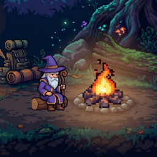
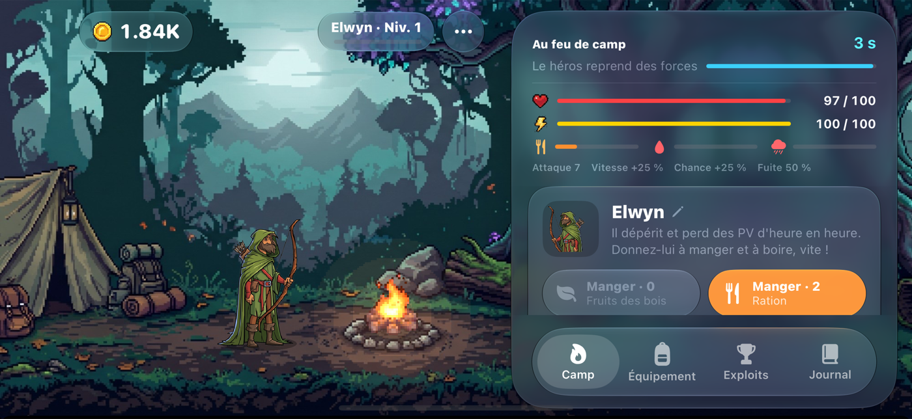
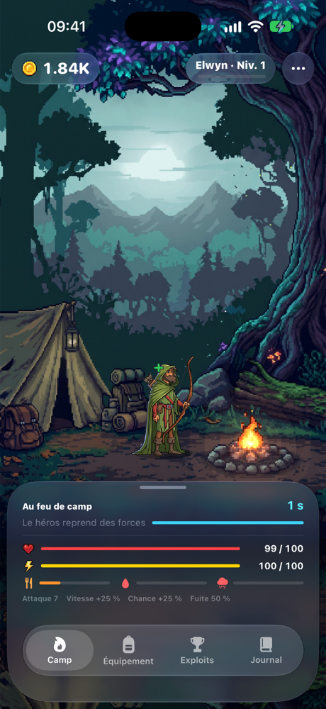
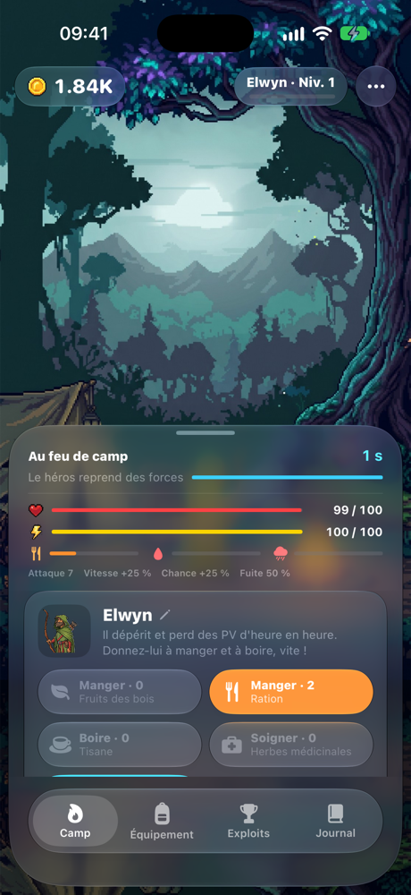
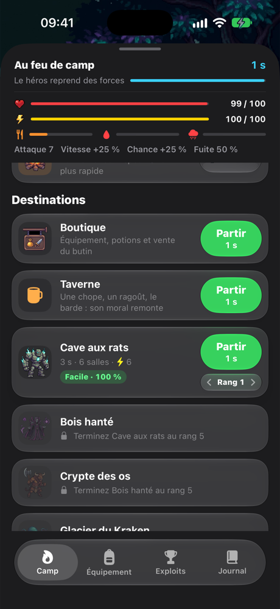
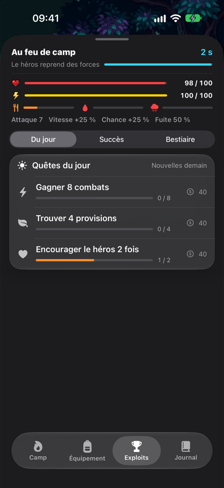
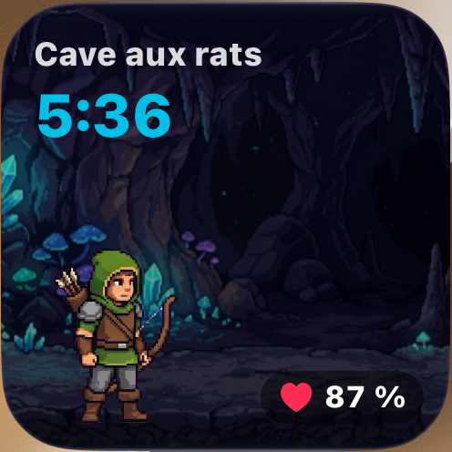

<p align="center">
  
</p>

<h1 align="center">Campfire Crawlers</h1>

<p align="center">
  Un jeu iOS natif, entre idle, Tamagotchi et roguelike, en pixel art.<br>
  Votre héros vit sa vie en temps réel : prenez soin de lui, envoyez-le en expédition… et ne l'oubliez pas.
</p>

<p align="center">
  
</p>

<p align="center">
  
  
  
  
</p>

<p align="center">
  
</p>

## Le principe

Le héros attend au feu de camp. On l'envoie dans un donjon, à la boutique, à la taverne ou en balade, et tout se déroule en **temps réel**, même application fermée. Une expédition dans le Volcan dure toute une journée : on revient voir où il en est, on le soigne, on prépare son sac, on choisit le prochain risque.

La mort est **définitive**. Une fuite qui rate, un héros oublié qui meurt de faim ou de soif, et c'est son successeur qui reprend le flambeau, avec le camp et un quart de l'or en héritage. Le jeu est réglé pour durer environ **deux mois**.

## Fonctionnalités

**Le héros**
- Trois classes : Guerrier (PV), Archer (vitesse et chance), Mage (attaque).
- Besoins vitaux : satiété, hydratation, moral. Un héros affamé ou assoiffé se bat et fuit moins bien, puis dépérit.
- Caractère qui se forge avec l'expérience : téméraire, prudent, gourmand, attachant.
- Soins au camp : nourrir, faire boire, encourager, soigner les blessures.
- Changer de héros, c'est abandonner l'actuel à son sort.

**L'aventure**
- Cinq donjons, chacun en cinq rangs (le Volcan sans limite). Il faut maîtriser un donjon au rang 5 pour ouvrir le suivant.
- Combats joués coup par coup, avec dégâts affichés, coup spécial à déclencher et potion à faire boire.
- Carrefours : une salle sur quatre propose trois bénédictions.
- Avant chaque départ, le jeu simule l'expédition avec les stats du héros : chance de réussite, risque de mort, provisions manquantes. Badge « Très dangereux » quand les chances sont faibles.
- Fuite qui peut échouer, selon la forme, la faim, la soif, les blessures et l'équipement.
- Provisions emportées : le héros mange et boit en route ce qu'on a mis dans son sac.

**Le village et le camp**
- Boutique : potions, rations, gourdes, parchemins, équipement, forge.
- Taverne : chope, ragoût et chanson du barde pour le moral.
- Balades sans danger dans la campagne pour ramasser des provisions.
- Feu de camp améliorable et sac de couchage pour mieux se reposer.

**Sur la durée**
- 14 succès récompensés, 3 quêtes du jour, bestiaire de 24 créatures.
- Notifications prévues à l'avance : arrivée, carrefour, faim, soif, « va bientôt mourir ».
- Activité en direct sur l'écran verrouillé et la Dynamic Island.
- Widgets : « Le héros » en petit, moyen et grand sur l'écran d'accueil, et en trois formats sur l'écran verrouillé ; « Veillée », le héros dans son décor, pensé pour le mode StandBy. Le héros y est animé selon ce qu'il fait : il se repose au camp, marche, se bat ou fuit.
- Interface Liquid Glass, en portrait comme en paysage.

## Technique

- **SwiftUI** pour l'interface (Liquid Glass, iOS 26), **SpriteKit** pour les scènes.
- **Simulation reproductible** : tout le hasard des règles passe par un générateur à graine (`SeededGenerator`). Le jeu peut donc rejouer l'avenir sur une copie de lui-même pour programmer les notifications et l'activité en direct au bon moment.
- **ActivityKit** et **WidgetKit** pour l'activité en direct et les widgets (extension `IdleRPGWidgets`). Les widgets ne pouvant pas être réveillés par le jeu, celui-ci rejoue la journée à venir et écrit d'avance une image du héros toutes les dix minutes dans un groupe d'apps partagé (`group.com.idlerpg.prototype`).
- Sauvegarde locale dans `UserDefaults`, compatible avec les anciennes versions.

### Organisation

| Dossier | Contenu |
|---|---|
| `IdleRPG/` | L'application : règles (`GameState.swift`, `World.swift`, `Item.swift`, `Exploits.swift`), scène (`WorldScene.swift`), interface (`ContentView.swift`, `MapPanel.swift`, `ExploitsPanel.swift`), notifications (`Outreach.swift`) |
| `IdleRPGWidgets/` | L'activité en direct et les widgets |
| `Shared/` | Les données partagées entre l'app et l'extension |
| `Art/` | Planches et scènes sources, scripts de découpe et d'export des sprites |
| `Outils/equilibrage.py` | Le simulateur d'équilibrage |
| `Archive/` | Les premières versions du prototype |

## Lancer le projet

Il faut **Xcode 27** et un simulateur ou un iPhone sous **iOS 26**. Sur un vrai iPhone, choisir son équipe dans l'onglet Signing des deux cibles : Xcode crée alors le groupe d'apps des widgets.

```bash
open IdleRPG.xcodeproj
```

Choisir le schéma `IdleRPG`, puis lancer.

### Mode test

Les vraies durées sont longues (17 h pour le Volcan). Dans le menu « … », le **mode test** accélère le temps ×240 : un donjon se joue en quelques secondes. Faim, soif et moral ralentissent d'autant pour rester jouables.

En debug, quelques arguments de lancement aident aussi :

| Argument | Effet |
|---|---|
| `-debugHero mage` | Change de classe (`warrior`, `archer`, `mage`) |
| `-debugGo 0` | Envoie le héros dans un donjon (0 à 4), à la boutique (`shop`), à la taverne (`tavern`) ou en balade (`roam`) |
| `-debugHeal YES` | Remet les PV et l'énergie au maximum et guérit les blessures |

## Équilibrage

`Outils/equilibrage.py` reproduit les règles du jeu en Python et simule des parties complètes, avec un joueur qui passe quatre fois par jour, du plus prudent au plus téméraire.

```bash
python3 Outils/equilibrage.py
```

Objectifs actuels : un joueur régulier finit le jeu en environ deux mois, meurt rarement s'il est raisonnable, et foncer reste la pire stratégie. Toute modification des règles doit être reportée dans le simulateur.

## Graphismes

Les héros, le marchand et les scènes peintes ont été générés puis découpés avec les scripts de `Art/` :

- `Art/import_heroes.py` découpe les planches de héros d'après `Art/heros/animations.json` ;
- `Art/import_sheets.py` et `Art/slicer.py` découpent les planches de monstres et d'objets ;
- `Art/scenes/` contient les décors, en 16:9 pour le paysage et en 9:16 pour le portrait.

`Art/ASSETS_ET_PROMPTS.md` recense toutes les images du jeu et les prompts utilisés.

### Héros animés des widgets

Un widget ne peut pas jouer d'animation, mais il sait faire avancer seul un chronomètre. `Outils/polices_widget.py` fabrique donc une police par classe et par animation, dont les chiffres 0 à 9 sont les images du sprite. Le widget écrit un chronomètre dans cette police et ne laisse voir que le chiffre des secondes : le héros change d'image chaque seconde. À relancer quand les sprites des héros changent :

```bash
python3 Outils/polices_widget.py
```
